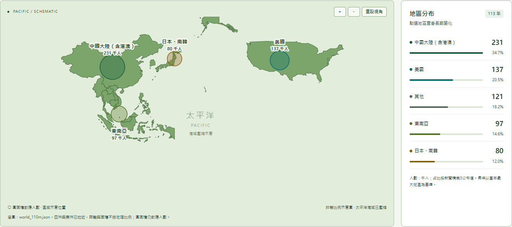

# 遠行的軌跡｜台灣人海外打工趨勢

綠色互動網站，以太平洋為中心的非等比例示意圖，搭配歷年趨勢與 **d3-brush 年份範圍框選**。

- 統計來源：行政院主計總處《113年國人赴海外工作人數統計新聞稿》，114年11月19日發布。
- 人數：PDF第11頁表6，民國88–113年，單位千人。
- 年增率與占比：PDF第8頁表3，直接採官方公布值。
- 地圖：使用者提供的 world_110m.json，僅提供地理形狀。
- GitHub：[專案倉庫](https://github.com/bailey-barr/115VIS-HW2-413085108--)。YouTube：**待上傳**，上傳後填入 config.js。

## 本機執行

Windows雙擊 `啟動網站.cmd`，保持視窗開啟，再瀏覽 http://127.0.0.1:4173 。結束時Ctrl+C。

或使用Node.js 18以上，在專案目錄執行：

```sh
node server.mjs
```

不需 npm install，D3與TopoJSON已附於vendor。勿直接雙擊index.html。若4173已占用，在PowerShell先執行 `$env:PORT = '4174'` 再啟動，並改瀏覽4174連接埠。

## 專案截圖與示範



[完整首頁](docs/screenshot-desktop.png) · [手機版](docs/screenshot-mobile.png) · [刷選示範](docs/screenshot-brush.png)

[操作影片](docs/demo.mp4)（1080p MP4、中文合成旁白、章節字幕）· [影片腳本](docs/video-script.md)

## 刷選與範圍框選（d3-brush）

本專案實際使用 `d3.brushX()`，在趨勢圖下方建立年份概覽選取帶。

1. 按住滑鼠拖曳框選年份，例如110–113年。
2. 拖曳選框可平移；拖曳兩側控制柄調整範圍。
3. `brush` / `end` 事件取得像素選區，以比例尺 `invert()` 轉回整數年份。
4. 更新共用 `state.range`，同步篩選趨勢圖、年度選單、滑桿、播放範圍與資料表。
5. 目前觀察年不在範圍內時，調整至最近端點；KPI與地圖仍顯示單一年份。
6. 起迄年份下拉選單以 `brush.move()` 同步選框；「重設範圍」回復全部26年。

起迄選單提供鍵盤與觸控替代方式。技術文件：[D3 d3-brush](https://d3js.org/d3-brush)。

## 地圖設計

沿用world_110m.json；以東經180°為中心，將投影後的中央海域水平區間360–640壓縮為470–530，兩側向中央平移110個SVG單位。因此亞洲與美洲更接近。

**地圖不按真實距離或面積比例呈現，不能用來量測地理距離。** 圓面積仍按人數映射，所有年度使用同一尺度。合併地區不拆分國家；「其他」無法定位，僅列於排行與趨勢。

## 資料來源與口徑

- [來源PDF](data/source-report.pdf)完整保留；[整理JSON](data/overseas-work.json)由附件抽取。
- `tools/extract-report.py`讀取表6的人數、表3的官方年增率及占比，不再讀取先前CSV。
- 113年：總計666千人，官方年增率 **7.4%**；美國137千人，官方占比 **20.5%**。不以表列千人數重算來替代公布比率。
- 題目沿用「海外打工」，正式統計為具有我國戶籍者赴海外工作人數；不等同打工度假簽證人數。
- 依第5頁編製方法：連結戶籍、入出國、勞保、健保等資料；先篩選經常或連續停留海外達90天者，再研判工作目的。
- 88–97年為先期研究，各年涵蓋國家與編製方法略有差異。
- 110年起由其他國家（地區）析出日韓；110年前其他包含未單列的日韓，不宜直接當作相同分類比較。
- 缺值不補零，表列總計與地區加總差異保留。

## 製作流程與相關操作

完整說明見 [guide.html](guide.html)。流程：PDF抽取及視覺核對 → 整理可追溯JSON → 綠色儀表板 → 非等比例太平洋地圖 → 地區與年份連動 → d3-brush範圍框選 → 瀏覽器驗證、截圖與錄影。

| 四層巢狀模型 | 本專案 |
| --- | --- |
| 領域情境 | 台灣人海外工作地區與歷年變化 |
| 資料與任務 | 年份、地區、人數、官方占比及年增率；比較分布與追蹤趨勢 |
| 視覺與互動 | 地圖圓面積、排行、折線、地區選取、雙圖連動、年份刷選 |
| 工程實作 | D3地理投影與自訂壓縮、TopoJSON、d3.brushX、單一狀態管理、本機HTTP |

## 檔案與驗證

`index.html`介面；`style.css`綠色響應式版面；`app.js`圖表與brush；`server.mjs`本機服務；`data/source-report.pdf`原始附件；`data/overseas-work.json`整理資料；`data/world_110m.json`底圖；`docs/`截圖影片與說明。

```sh
node tests/verify-data.mjs
node --check app.js
node --check server.mjs
```

抽取器重跑需Python與pypdf；平常使用網站不需Python。驗證紀錄見 [docs/verification.md](docs/verification.md)。

## GitHub / YouTube

GitHub專案倉庫：https://github.com/bailey-barr/115VIS-HW2-413085108-- 。YouTube影片尚未上傳，上傳後更新config.js。GitHub Pages可發布main根目錄；YouTube可上傳docs/demo.mp4。所有資源採相對路徑，前端無須CDN。

## 技術與參考

原生HTML/CSS/JavaScript、D3.js 7.9.0（含d3-brush）、TopoJSON client 3.1.0；程式庫授權見vendor。參考[新生註冊率視覺化專案](https://github.com/powerkaifu/1151VIS-HW2-415085011-CHANG-KAI-FU)資訊架構；該網址是參考專案，不是本專案倉庫。

地圖只繪製中國大陸（含港澳）、東南亞、美國、日本與南韓；東南亞按來源包含10國。110m底圖沒有的微小國家輪廓不另行虛構。其他地區仍保留在統計圖表。新版使用更深的綠色文字、明確的邊界和較深的圖表色彩，提高對比。
