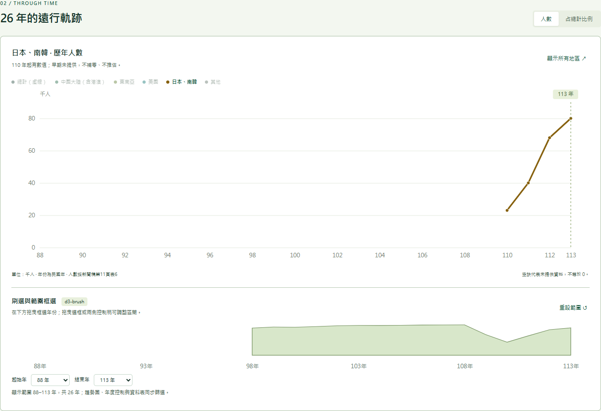
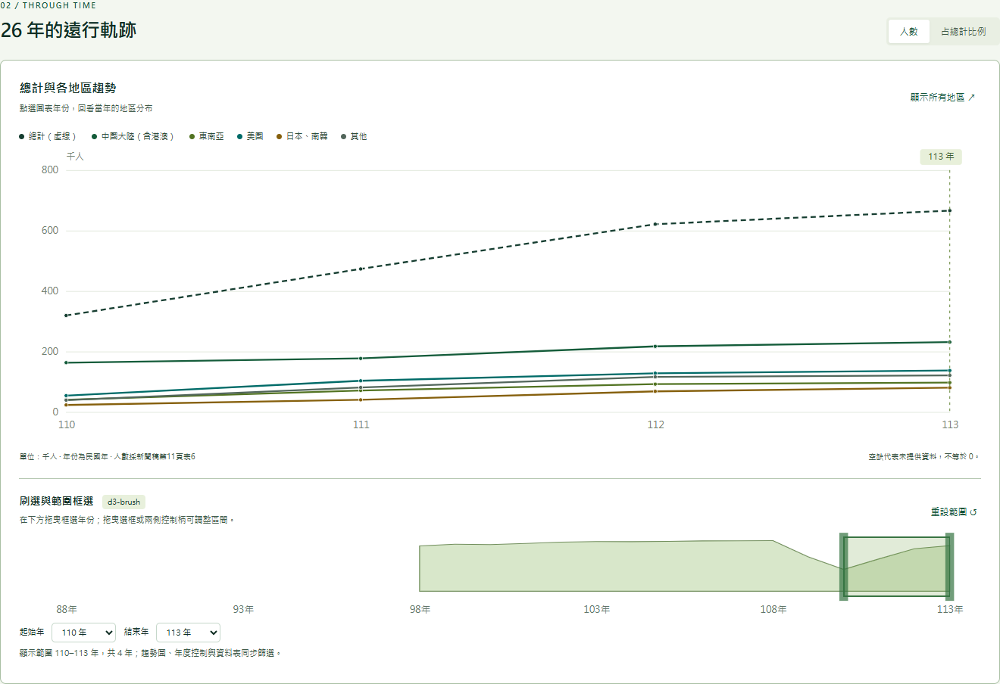

# HW02 作業說明

課程名稱：資料分析與視覺化應用  
學號姓名：413085108 張亦筠  
GitHub Repository：[https://github.com/bailey-barr/115VIS-HW2-413085108-YIYUN-JHANG](https://github.com/bailey-barr/115VIS-HW2-413085108-YIYUN-JHANG)（[GitHub Pages](https://bailey-barr.github.io/115VIS-HW2-413085108-YIYUN-JHANG/)）  
作業網址：[台灣人海外打工趨勢](https://bailey-barr.github.io/115VIS-HW2-413085108-YIYUN-JHANG/)  
影片網址：[視覺互動展示影片][(https://bailey-barr.github.io/115VIS-HW2-413085108-YIYUN-JHANG/docs/demo.mp4](https://youtu.be/h3x3_but4dU)](https://youtu.be/h3x3_but4dU)
資料來源：行政院主計總處[《113年國人赴海外工作人數統計新聞稿》](https://www.stat.gov.tw/News_Content.aspx?n=3703&s=235501)，114年11月19日發布。

## 專案執行成果展示

### 1. 太平洋地圖與地區分布

以太平洋為中心的非等比例示意圖，呈現中國大陸（含港澳）、東南亞、美國、日本與南韓的人數分布。


### 2. 日本、南韓歷年趨勢

選取地區後連動歷年折線圖；日本與南韓依來源資料合併呈現。



### 3. 年份刷選與範圍框選

框選110至113年，趨勢圖、年度控制與資料表同步篩選。



[完整首頁截圖](docs/screenshot-desktop.png) · [手機版截圖](docs/screenshot-mobile.png) · [靜音展示影片](docs/demo.mp4)

## 開發環境與技術棧

以下列出本專案實際使用或驗證的版本；HTML、CSS與JavaScript為瀏覽器原生技術，不另安裝套件。

| 項目 | 版本／規格 | 用途與說明 |
| --- | --- | --- |
| 專案 | 2.0.0 | package.json記錄的專案版本 |
| 開發環境 | Windows、PowerShell | 本機開發及啟動腳本 |
| Node.js | 24.22.1；專案要求18以上 | 使用內建HTTP模組啟動本機伺服器，無須npm install |
| HTML | HTML5 | 語意化頁面、控制項與影片播放器 |
| CSS | CSS3，含Grid／Flexbox | 高對比綠色版面與響應式配置 |
| JavaScript | ES2015+語法 | 狀態管理、資料載入與互動控制 |
| D3.js | 7.9.0 | 地圖、比例尺、折線圖、縮放與刷選；已附於vendor |
| d3-brush | 隨D3.js 7.9.0整合使用 | 以d3.brushX進行年份框選，未另行安裝獨立套件 |
| TopoJSON Client | 3.1.0 | 將world_110m.json轉為可繪製的地理形狀 |
| Python | 3.12.14 | 重新執行PDF資料抽取時使用，瀏覽網站不需要 |
| pypdf | 6.21.4 | 抽取新聞稿表格數據 |
| Microsoft Edge | 157.0.4341.42 | 本機瀏覽與互動驗證版本 |
| GitHub Pages | 靜態網站託管服務 | 從main分支根目錄發布；無專案可鎖定的服務版本 |

## 運用Ware的理論呈現供應鏈重組

本專案以「供應鏈重組下，海外工作布局由中國集中轉向其他地區」為分析主題，運用Colin Ware的認知與感知觀點，讓使用者透過視覺差異、趨勢辨識與互動操作理解資料。

新聞稿指出，中國大陸（含港澳）工作者占比受生產成本上升、臺商回流及供應鏈重組等因素影響，自100年的62.2%降至113年的34.7%。以疫情前108年比較113年，美國人數由92千人增加至137千人，占比由12.5%提高至20.5%，呈現海外工作人口配置的結構變化。

「勞工從中國轉往其他地區」在此指整體分布的轉變。資料沒有追蹤同一位工作者的跨國移動，因此不能據此認定原本在中國的勞工直接轉往其他國家；東南亞113年97千人也仍低於108年的120千人，不能將各地區一概解讀為持續成長。

| 認知與感知概念 | 本專案的應用 | 幫助讀者理解的問題 |
| --- | --- | --- |
| 第一個概念：視覺顯著性與注意力 | 以高對比標示選取地區，其餘資訊淡化 | 「中國跟日本做比較」 |
| 第二個概念：圖樣辨識 | 用折線的位置、方向與轉折呈現年度變化 | 「中國的占比是否長期下降？」 |
| 第三層概念：視覺工作記憶 | 地圖、折線與排行使用一致配色，保留數值標籤 | 減少來回記憶地區名稱與數字的負擔 |
| 探索性操作 | 用d3.brushX框選年份並連動圖表 | 「目前是否為較長期的結構變化？」 |

表中的概念順序是本作業的應用整理。依原始資料分類，「中國跟日本做比較」實際操作為比較「中國大陸（含港澳）」與「日本、南韓」合併組，無法單獨析出日本。可依序選取地區查看趨勢，再切回全部地區並切換占比模式比較。

刷選100–108年可觀察疫情前的長期趨勢；108–110年可觀察疫情及其他因素交織的衝擊；110–113年則可觀察復甦，再與108年基準比較。這種操作將「是否發生結構變化」轉換為可在圖表上檢查的視覺問題。

理論參考：[Colin Ware, Visual Thinking Algorithms](https://visigrapp.scitevents.org/Documents/Previous_Invited_Speakers/2012/VISIGRAPP2012_Ware.pdf)。其中的視覺查詢、圖樣辨識、視覺工作記憶與探索性操作，是本專案設計的參考。

## 本機執行

Windows雙擊「啟動網站.cmd」，保持視窗開啟，再瀏覽 http://127.0.0.1:4173 。結束時按Ctrl+C。

也可在專案目錄執行：

```sh
node server.mjs
```

不需npm install，D3與TopoJSON已附於vendor。勿直接雙擊index.html。若4173已占用，在PowerShell先執行 `$env:PORT = '4174'` 再啟動，並改瀏覽4174連接埠。

## 製作流程

1. **整理官方資料**：以行政院主計總處《113年國人赴海外工作人數統計新聞稿》為統計來源，使用 Python 與 pypdf 抽取資料。人數取自第11頁表6，官方年增率與占比取自第8頁表3，整理為 `data/overseas-work.json`；原始新聞稿保留於 `data/source-report.pdf`。
2. **核對統計口徑**：以民國年及千人為單位，缺值保留為空值，不補成零；年增率與占比直接採官方公布值。日韓自110年起單列，跨年比較時保留分類變動提示。
3. **建立網頁版面**：以 HTML、CSS 與 JavaScript 製作綠色高對比儀表板，依序呈現年度摘要、地區地圖、歷年趨勢、Ware 理論及專案成果，並調整桌面與手機版面。
4. **繪製太平洋地圖**：透過 TopoJSON Client 解析 `world_110m.json`，使用 D3 地理投影，以太平洋為中心並壓縮中央海域。只呈現指定的四組目的地，圓面積對應工作人數；地圖為非等比例示意，不能用於量測距離。
5. **串接圖表互動**：以共用狀態管理年份、地區、顯示模式與年份範圍，連動地圖、排行、折線圖、年度控制及資料表。使用 `d3.brushX()` 實作框選、控制柄調整與選區平移。
6. **加入 Ware 理論與分析情境**：以一致配色、高對比選取、折線趨勢及互動刷選協助辨識結構變化，加入疫情前、衝擊期、復甦期三個區間入口，探索供應鏈重組背景下的海外工作分布。
7. **測試與製作展示成果**：檢查資料、缺值、互動連動及手機版面，擷取三張成果圖片；錄製新版網站操作，輸出2分鐘、1080p、無音軌的靜音 MP4，搭配畫面字幕與章節說明。
8. **本機與線上發布**：使用 Node.js 啟動本機 HTTP 服務；將網站檔案上傳 GitHub，由 GitHub Pages 發布 main 分支根目錄，確認網站、資料與影片連結正常。

## 相關操作說明

| 操作項目 | 操作方式 | 畫面結果 |
| --- | --- | --- |
| 選取觀察年份 | 使用年份下拉選單、年度滑桿，或點選折線圖年份 | 同步更新當年指標、地圖與地區排行 |
| 播放年度變化 | 點選「播放」，再點一次可暫停 | 在目前選取的年份範圍內逐年播放，到尾端停止 |
| 選取地區 | 點選地圖圓點、排行、地區按鈕或圖例 | 顯示該地區的歷年趨勢；再次點選可解除，也可按「顯示所有地區」 |
| 切換人數與占比 | 點選「人數」或「占總計比例」 | 分別觀察工作人數規模與地區相對比重 |
| 框選年份 | 在趨勢圖下方的年份概覽按住滑鼠拖曳 | 以 `d3.brushX` 篩選範圍，同步更新趨勢、年度控制與資料表 |
| 調整或平移選區 | 拖曳選框兩側控制柄，或拖曳選框中間 | 調整起迄年份，或平移整段觀察區間 |
| 以選單設定範圍 | 使用「起始年」與「結束年」選單 | 與刷選框同步，提供鍵盤與觸控替代操作 |
| 重設年份範圍 | 點選「重設範圍」 | 回復民國88–113年全部資料 |
| 探索三個時期 | 在 Ware 理論區點選100–108、108–110或110–113年按鈕 | 切換至各地區占比圖，連動範圍並移至歷年趨勢區 |
| 調整地圖視角 | 使用＋／－、拖曳地圖或按「重設視角」 | 放大、縮小、平移或回復地圖；手機可左右滑動地圖區 |
| 檢視精確數值 | 游標停留於圖表資料點，或展開「檢視範圍內資料表」 | 查看提示數值及選取區間內各年度資料 |
| 查看成果與文件 | 點選成果圖片、作業說明、影片或來源 PDF 連結 | 開啟完整截圖、文件與靜音展示影片 |

建議先選取中國大陸（含港澳）觀察占比，再選取日本、南韓比較趨勢；接著利用三個時期按鈕與年份刷選，區分長期變化與疫情期間的波動。日韓為合併統計，不能單獨解讀為日本；資料呈現整體分布，不能據此追蹤同一批勞工從中國轉往其他地區。

年份刷選後，地圖與年度指標仍代表「目前觀察年」，不會把多年工作人數加總；若觀察年落在範圍外，系統會調整至範圍端點。
